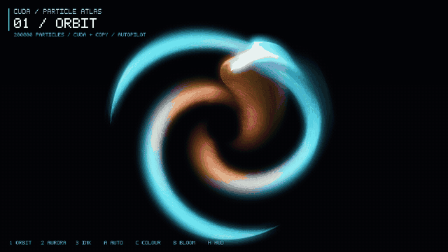

# CUDA from Scratch — Particle Atlas

A step-by-step CUDA course for people who come from creative coding. Seven tiny
programs that build up the fundamentals, ending in an interactive GPU particle
system you stir with the mouse. Hundreds of thousands of particles become a
spiral galaxy, flowing aurora curtains, and luminous ink: real CUDA simulation,
persistent HDR trails, soft bloom, and no engine or UI framework.

<p align="center">
  
</p>

**Six small lessons. Three living canvases. One GPU playground.**

[Smaller WebP recording](docs/demo.webp) · [Still preview](docs/preview.png) ·
[Implementation review & learning exercises](docs/01_learning_notes.md)

```
   examples/01  hello, GPU              →  kernels, threads, blocks
   examples/02  vector add              →  device memory, copying, errors
   examples/03  index math              →  thread-per-element, grid-stride loops
   examples/04  shared memory           →  tiles, __syncthreads, bank conflicts
   examples/05  timing & streams        →  events, overlap, pinned memory
   examples/06  CUDA ↔ OpenGL interop   →  the bridge to the final project
   particles/                           →  the final project
```

## Quick start

```bash
# 1. install the toolkit (Arch / CachyOS / Manjaro)
sudo pacman -S cuda glfw libglvnd pkgconf make gcc
export PATH=/opt/cuda/bin:$PATH        # optional; the Makefile finds /opt/cuda

# 2. see what you have
make doctor

# 3. walk the path
make run-01_hello
make run-02_vector_add
make run-03_index_math
make run-04_shared_memory
make run-05_timing_streams
make run-06_interop                    # a window, a CUDA-animated triangle

# 4. the final project
make run-particles
make demo                             # hands-free tour of all three scenes
```

Linux, an NVIDIA CUDA-capable GPU, and **GLFW 3.4+** are required for the full
project. `nvcc` not installed yet? → **[docs/00_setup.md](docs/00_setup.md)** covers the
whole setup, what `nvcc` actually does, and how to fix the usual failures.

## The final project

```bash
make run-particles
make run-particles ARGS="--count 1000000 --fade 0.05"
make run-particles ARGS="--scene aurora"
make demo ARGS="--count 200000"
```

| input | effect |
|---|---|
| move the mouse | the cloud follows and swirls around the cursor |
| left button | strong attraction |
| right button | strong repulsion |
| `1` / `2` / `3` | **Orbit** / **Aurora** / **Ink**; re-seeds the scene |
| `A` | toggle autopilot (changes scenes every eight seconds) |
| `C` | cycle ice/fire, aurora, and neon palettes |
| `B` | toggle bloom |
| `H` | show / hide the on-canvas overlay |
| `space` | pause / resume |
| `R` | re-seed the cloud |
| `+` / `-` | bigger / smaller particles |
| `up` / `down` | longer / shorter trails |
| `ESC` | quit |

Options: `--count N` (default 400 000), `--fade F` (decay at 60 Hz, default
0.035; `0` leaves permanent trails), `--size P` (default 1.6 pixels),
`--scene orbit|aurora|ink`, `--exposure F`, `--demo`, `--no-hud`,
`--width W`, `--height H`. Run `./build/particles --help` for ranges and capture options.

**Orbit** starts with three spiral arms and differential rotation. **Aurora**
advects five coloured bands through an undulating field with wraparound edges.
**Ink** uses the curl of a stream function to create rolling eddies. All three
react to cursor position **and cursor velocity**. The fields are intentionally
art-directed, not an N-body gravity or fluid solver.

### How it works

The default interop path keeps particle data on the GPU throughout each frame:

```
   ┌─────────────────────────── GPU ───────────────────────────┐
   │                                                           │
   │  1. CUDA writes positions + colours                       │
   │        straight into the OpenGL vertex buffers            │
   │                                                           │
   │  2. fade a persistent RGBA16F framebuffer, then draw       │
   │        additive point sprites          →  HDR trails      │
   │                                                           │
   │  3. two quarter-resolution blur passes → soft bloom       │
   │        exposure + tone map + vignette  →  final image      │
   │                                                           │
   └───────────────────────────────────────────────────────────┘
```

The whole exchange is five calls, the same ones you write by hand in
`examples/06_interop`:

```cpp
cudaGraphicsMapResources(2, resources, 0);          // let CUDA in
cudaGraphicsResourceGetMappedPointer(...);          // here is the device pointer
particles_update<<<grid, block>>>(...);             // simulate straight into it
cudaGraphicsUnmapResources(2, resources, 0);        // hand it back to OpenGL
glDrawArrays(GL_POINTS, 0, count);                  // draw
```

### The simulation

`particles/src/physics.cu` is the whole story: one thread per particle, no
shared memory, no synchronisation. Each particle feels

* a softened radial pull toward the cursor, damped by a gaussian so only nearby
  particles react;
* a **swirl** — the same force rotated 90°, which is what makes it curl instead
  of collapsing;
* a scene-specific flow field and local momentum from dragging the cursor;
* a pinch of random jitter, so the field never freezes;
* exponential damping toward rest;
* a soft bounce off the edges.

Aurora and ink colour by flow direction and position; orbit colours by birth
radius, preserving cyan/amber structure as its arms shear. Brightness follows
speed. Palettes use simple trigonometric gradients—cheap enough to evaluate
per particle, with no textures or lookup tables.

Simulation steps are capped at 1/120 second. Damping, trail decay, and deposited
light use elapsed time rather than assuming 60 FPS. Pausing freezes both the
simulation and its trail history. Resetting and resizing clear stale trails.
The history lives in an explicit framebuffer: it never depends on undefined
contents of a swapped back buffer. Tone mapping happens *after* accumulation,
so bright overlaps retain more colour instead of clipping immediately.

Every magic number sits at the top of the frame loop in
`particles/src/main.cu` (`attraction`, `swirl`, `damping`, `jitter`, `radius`).
Change one, rebuild, and watch what happens. That is the fastest way to build
intuition.

### Hybrid-GPU fallback

If your GL context is on Intel/AMD, or NVIDIA interop is unavailable:

```bash
make run-particles RUN= ARGS="--staged --demo"
```

This is **still a real CUDA simulation**, but copies positions and colours
GPU → CPU → OpenGL every frame. It is slower and explicitly labeled
`CUDA + COPY` in the overlay. It is never selected silently. Example 06 stays
interop-only so it teaches the ownership transfer without hiding it.

### Make your own recording

```bash
# Python 3 + ffmpeg; gifsicle is used if available
make gif                              # 24 seconds: one complete scene tour
make gif RUN= ARGS="--staged"          # the hybrid-GPU fallback
make gif ARGS="--seconds 8 --count 100000 --output /tmp/opencode/my-demo"
```

`scripts/record_demo.py` creates `docs/demo.gif`, `docs/demo.webp`, and
`docs/preview.png`. It renders a hidden 960×540 window at a fixed 60 Hz simulation
step and reads every other frame. A full tour is edited into a 12-second montage
(four mature seconds per scene), encoded as a 15 FPS GIF and a 20 FPS WebP.
Expect roughly 1.1 GB
of temporary frames for the full tour; only this script's temporary directory
is removed afterward. The tour loops, with deliberate scene cuts.

This checked-in recording uses 200 000 particles and the staged path because
the recording machine's NVIDIA OpenGL driver was unavailable. The simulation,
shaders, and post-processing are the same as the default path; no FPS claim is
inferred from an offline recording. Capture itself reads pixels back to the CPU.
VHS is great for recording the *terminal lessons*; direct framebuffer capture
records the actual OpenGL artwork without window-manager clutter.

## Repository layout

```
cuda-particles/
├── Makefile                  build everything, or one thing
├── common/cuda_check.h       CUDA_CHECK — use it, always
├── docs/00_setup.md          installing the toolkit, troubleshooting
├── docs/01_learning_notes.md review, follow-up exercises, validation
├── scripts/                  GIF/WebP capture and render smoke tests
├── tests/physics.cu          display-free GPU regression checks
├── examples/
│   ├── 01_hello/main.cu
│   ├── 02_vector_add/main.cu
│   ├── 03_index_math/main.cu
│   ├── 04_shared_memory/main.cu
│   ├── 05_timing_streams/main.cu
│   └── 06_interop/main.cu
└── particles/
    ├── src/main.cu           window, GL state, frame loop
    ├── src/physics.cu        the kernels
    ├── src/particles.cuh     shared data layout
     ├── src/shaders.h         GLSL
     ├── src/render.h          HDR history, bloom, tone mapping
     └── src/hud.h             tiny dependency-free overlay
```

Each example is a single self-contained `.cu` file with heavy comments. The
final project is split across files the way a real one would be.

## Build options

```bash
make                       # everything
make 01_hello              # one example
make run-03_index_math     # build & run one example
make particles             # just the final project
make check                 # numerical lessons + GPU physics regression checks
python3 scripts/smoke_test.py --runner prime-run   # window/render/capture tests
python3 scripts/smoke_test.py --staged             # explicit fallback tests
make clean

make ARCH=sm_75            # compile for a specific GPU instead of `native`
make UNSUPPORTED=1         # if nvcc rejects your (newer) host GCC
make NVCC=/opt/cuda-12.6/bin/nvcc
```

`-arch=native` asks `nvcc` to detect your card at compile time, so you normally
never touch `ARCH`. Your GTX 1650 Mobile is Turing, `sm_75`.

## Troubleshooting

**`nvcc: command not found`** — install the `cuda` package. The Makefile falls
back to `/opt/cuda/bin/nvcc`, so `make doctor` should still find it.

**`unsupported GNU version! gcc 16 is not supported`** — `make UNSUPPORTED=1`.
See `docs/00_setup.md` for the details and for using an older host compiler.

**`nvidia-smi`: driver/library version mismatch** — the loaded kernel module
and installed NVIDIA userspace libraries differ (often after an update). Finish
the matching driver update and reboot into the matching module. `prime-run`
cannot fix a version mismatch. CUDA may still work while NVIDIA OpenGL context
creation fails; `--staged` can help in that case, but requires working CUDA.

**Windowed examples fail with "Cannot pair CUDA with this OpenGL context"** —
you are on a laptop with hybrid graphics (Optimus): the window was created on
the integrated GPU, so CUDA and OpenGL are on different devices and cannot
share buffers. Move the GL context to the NVIDIA GPU:

```bash
prime-run make run-particles
# or, equivalently:
__NV_PRIME_RENDER_OFFLOAD=1 __GLX_VENDOR_LIBRARY_NAME=nvidia make run-particles
```

`make run-X` already does this for you when `prime-run` (package
`nvidia-prime`) is installed. Override with `make run-particles RUN=`.

**Blank window (and the GPU check above passed)** — the particle examples
default to an **X11 (XWayland) GL context**, because GLX is the well-supported
path for CUDA/OpenGL interop on Linux. To try a native Wayland (EGL) context
instead:

```bash
CUDA_PARTICLES_PLATFORM=wayland make run-particles
CUDA_PARTICLES_PLATFORM=any     make run-particles
```

**Everything compiles but the output is all zeros** — a kernel failed silently.
Wrap calls in `CUDA_CHECK(...)` (see `common/cuda_check.h`) and add
`CUDA_CHECK_KERNEL()` after the launch; it will tell you what went wrong and
where.

**Sluggish at 400 000 particles** — lower `--count`, or check the FPS in the
title bar. The simulation is trivially parallel; if it is slow, it is almost
always the *fill rate* of the points, so try a smaller `--size`.

**`nvcc fatal : Unsupported gpu architecture 'compute_XX'`** — you asked for an
architecture this toolkit does not know. Drop `ARCH` and use `native`.

## Ideas to take it further

Ordered roughly by difficulty:

* Colour by position instead of velocity — one line in `update_kernel`.
* Give particles a finite life: recycle the dead ones at the cursor, and watch
  it turn into a fountain.
* Distort the history in a ping-pong framebuffer for fluid-like feedback.
  The current fade uses blending in one persistent FBO; blur uses separate targets.
* Sort particles for painter's algorithm, or render them as instanced quads
  instead of point sprites.
* Read `ncu` (Nsight Compute) output for `update_kernel` and find out whether it
  is memory- or compute-bound. Then make it faster.
* Add a genuinely interacting simulation with a spatial grid; compare its cost
  and synchronization needs with the current independent-particle kernels.

## License

MIT — see [LICENSE](LICENSE).
